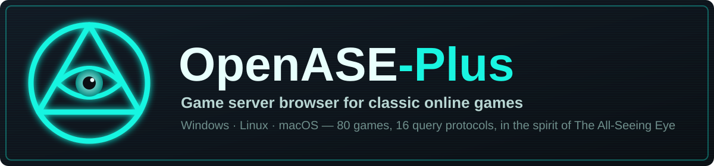

[English](README.md) | [Français](README.fr.md) | [Español](README.es.md) | [Português](README.pt.md) | **Italiano** | [Deutsch](README.de.md) | [Русский](README.ru.md)

# OpenASE-Plus

**The All-Seeing Eye ti tiene ancora d'occhio.** Trova un server per i giochi classici che ami ancora ed entra con un doppio clic.

OpenASE-Plus è un browser di server gratuito per Windows, Linux e macOS, nello spirito del vecchio *All-Seeing Eye*. Scegli un gioco, guarda chi sta giocando adesso ed entra: niente comandi da console, niente IP da copiare.

<table>
  <tr>
    <td></td>
    <td></td>
  </tr>
</table>

Server di Quake 3 nei temi Classic, Dark e GoldSrc.

**[⬇ Scarica](https://github.com/OpenGamePlus/OpenASE-Plus/releases/latest)** · gratuito e open source (GPL-3.0)

## Cosa fa

- 🎮 **80 giochi classici in un solo posto**: Quake, Call of Duty, Unreal Tournament, Counter-Strike, Medal of Honor, Battlefield, Tribes e molti altri.
- ⚡ **Doppio clic per giocare**: trova i giochi installati e li avvia già connessi, con la mod e la password giuste.
- 📶 **Ping, Flux e perdita di pacchetti** misurati come nell'ASE originale, più la versione di ogni server.
- 🔎 **Trova subito il server giusto**: filtra per tipo di gioco, mod, mappa, versione, ping o paese; nascondi i server vuoti, pieni o con password; crea i tuoi filtri.
- ⭐ **Preferiti, amici e server recenti**, così il server del tuo clan è sempre a un clic.
- 🔔 **Ricevi un avviso** quando si libera un posto su un server pieno, quando una partita si sta riempiendo o quando un amico si collega.
- 👥 **In gioco ora**: un elenco di tutti i server con giocatori in tutti i tuoi giochi.
- 🏠 **LAN party**: trova i server della tua rete locale.
- 🎨 **Sei temi**, da Classic a Synthwave e GoldSrc, in sette lingue: inglese, francese, spagnolo, portoghese, italiano, tedesco e russo.
- 🛠 **Per gli amministratori di server**: una console RCON e uno strumento da riga di comando.

Tutte le funzioni in dettaglio: la [guida utente](docs/user-guide.md) (in inglese).

## Giochi supportati

Raggruppati in base a come parlano con i loro server (il loro protocollo di interrogazione).

| Protocollo | Giochi |
|---|---|
| Quake 3 | Quake 3: Arena, Urban Terror, OpenArena, Xonotic, Warsow, Warfork, Tremulous, Smokin' Guns, Wolfenstein: Enemy Territory, Return to Castle Wolfenstein, Call of Duty, Call of Duty: United Offensive, Call of Duty 2, Call of Duty 4: Modern Warfare, Star Wars Jedi Knight II: Jedi Outcast, Star Wars Jedi Knight: Jedi Academy, Star Trek: Voyager Elite Force, Soldier of Fortune II |
| Quake 2 e QuakeWorld | Quake 2, Kingpin, QuakeWorld |
| Doom 3 | DOOM 3, Quake 4 |
| Zandronum | Zandronum (Doom) |
| GameSpy | Unreal Tournament, Unreal, Deus Ex, Rune, Wheel of Time, Mobile Forces, Serious Sam: The First e Second Encounter, No One Lives Forever 1 e 2, Heretic II, Gore, Drakan, Turok 2, Global Operations, Vietcong, Star Trek: Bridge Commander, Medal of Honor: Allied Assault (+ Spearhead, Breakthrough), Battlefield 1942, SWAT 4, Soldier of Fortune |
| GameSpy v2 e v3 | Battlefield 2, Battlefield Vietnam, Halo: Combat Evolved, Halo: Custom Edition, Tribes: Vengeance, F.E.A.R., Star Wars: Battlefront |
| Unreal Engine 2 | Unreal Tournament 2004, Unreal Tournament 2003 |
| Tribes | Starsiege: Tribes, Tribes 2 |
| Valve (Steam)\* | Counter-Strike 1.6, Condition Zero, Team Fortress Classic, Day of Defeat, Half-Life, Opposing Force, Deathmatch Classic, Ricochet, Counter-Strike: Source, Day of Defeat: Source, Half-Life 2: Deathmatch, Team Fortress 2, Left 4 Dead, Left 4 Dead 2, Garry's Mod |
| Propri | Multi Theft Auto: San Andreas, Savage: The Battle for Newerth, Rainbow Six 3: Raven Shield, Ghost Recon e The Sum of All Fears (+ demos) |

\* Richiede una [chiave Steam Web API](docs/user-guide.md#steam-games) gratuita per l'elenco dei server.

Quali server master usa ogni gioco: [giochi e master](docs/games-and-masters.md).
Manca il tuo gioco? [Apri una issue](https://github.com/OpenGamePlus/OpenASE-Plus/issues).

> [!IMPORTANT]
> **Nessun gioco incluso.** OpenASE-Plus elenca i server e avvia i giochi che hai già installato.

## Per iniziare

1. **Scarica** il pacchetto per il tuo sistema dalle [Releases](https://github.com/OpenGamePlus/OpenASE-Plus/releases/latest): uno `.zip` per Windows, un AppImage o un `.tar.gz` per Linux, uno `.zip` per macOS ([dettagli](docs/user-guide.md#install)).
2. **Avvialo.** Windows e macOS possono avvisarti perché l'app non è firmata; su Windows fai clic su **Ulteriori informazioni → Esegui comunque**, su macOS fai clic destro sull'app e scegli **Apri**.
3. **Lascia che trovi i tuoi giochi** con la ricerca automatica al primo avvio.
4. **Scegli un gioco, premi `F5`, fai doppio clic su un server.** Tutto qui.

OpenASE-Plus ti avvisa quando esce una nuova versione.

> [!NOTE]
> **Prima versione.** Il comando per entrare di molti dei nuovi giochi non è stato provato con il gioco installato. Segnala cosa non va nelle [issues](https://github.com/OpenGamePlus/OpenASE-Plus/issues).

## Per saperne di più

La documentazione collegata è in inglese.

- 📖 [Guida utente](docs/user-guide.md): tutte le funzioni, le scorciatoie, i giochi Steam e dove sono salvate le impostazioni.
- 🛰 [Giochi e master](docs/games-and-masters.md): i server master di ogni gioco.
- 💻 [Riga di comando (`openase-cli`)](docs/cli.md): le stesse interrogazioni senza finestra, con output JSON.
- 🛠 [Compilare e contribuire](docs/README.md): documentazione tecnica, [compilazione](docs/development/building.md), [aggiungere un gioco](docs/development/adding-a-game.md), [CONTRIBUTING.md](CONTRIBUTING.md).
- 📜 [Cosa è cambiato](CHANGELOG.md) e [cosa arriverà](ROADMAP.md).

## Informazioni

OpenASE-Plus è un fork di [OpenASE](https://github.com/tsautier/OpenASE) di Thomas Sautier e fa parte della famiglia [OpenGamePlus](https://github.com/OpenGamePlus). Oltre a OpenASE, porta le funzioni di JASE, un browser precedente dello stesso manutentore: più giochi, avvisi, link, RCON, temi, bandiere e immagini delle mappe. Come il resto della famiglia, è sviluppato con assistenti di programmazione IA. È codice nuovo: non usa, modifica né distribuisce nulla del programma originale di Yahoo, e non è affiliato né a Yahoo né agli autori originali di The All-Seeing Eye.

Grazie alle comunità che tengono vivi questi giochi: 333networks, OpenSpy, dpmaster, jkhub, 1fxmod, TribesNext, OpenRVS, Savage DRX e molte altre.

## Licenza

Copyright (C) 2026 Thomas Sautier (OpenASE)  
Copyright (C) 2026 OpenGamePlus contributors (OpenASE-Plus)

OpenASE-Plus è software libero sotto la GNU General Public License, versione 3 o successiva; vedi [LICENSE](LICENSE). I nomi dei giochi sono marchi dei rispettivi proprietari. Geolocalizzazione IP di [DB-IP](https://db-ip.com) (CC BY 4.0), scaricata durante l'uso. Bandiere da [flag-icons](https://github.com/lipis/flag-icons) (MIT, `rust/assets/flags-LICENSE.txt`). Nessun file dell'ASE originale è distribuito con questo progetto.
