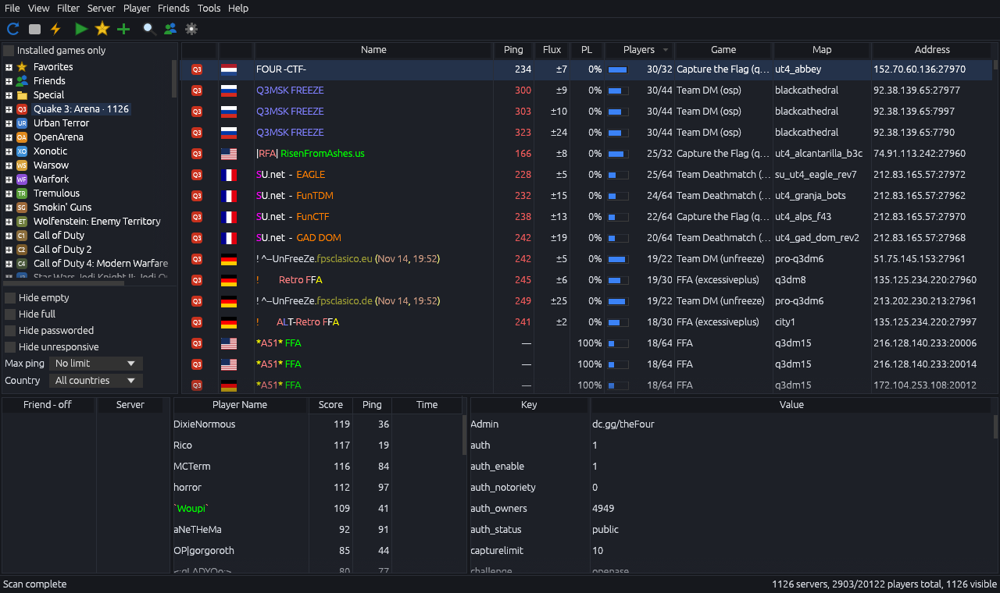
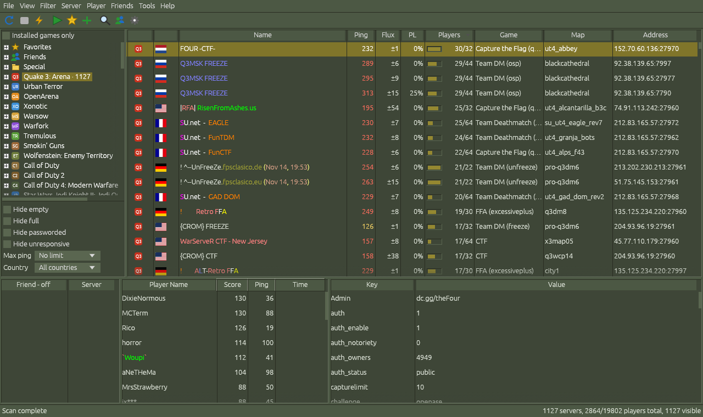

**English** | [Français](README.fr.md) | [Español](README.es.md) | [Português](README.pt.md) | [Italiano](README.it.md) | [Deutsch](README.de.md) | [Русский](README.ru.md)

# OpenASE-Plus

**The All-Seeing Eye is still watching.** Find a server for the classic games you
still love, and join it with a double-click.

OpenASE-Plus is a free server browser for Windows, Linux and macOS, in the spirit
of the old *All-Seeing Eye*. Pick a game, see who is playing right now, and jump
in: no console commands, no copying IPs.

<table>
  <tr>
    <td></td>
    <td></td>
  </tr>
</table>

Quake 3 servers in the Classic, Dark and GoldSrc themes.

**[⬇ Download](https://github.com/OpenGamePlus/OpenASE-Plus/releases/latest)** · free and open source (GPL-3.0)

## What it does

- 🎮 **80 classic games in one place**: Quake, Call of Duty, Unreal Tournament, Counter-Strike, Medal of Honor, Battlefield, Tribes and many more.
- ⚡ **Double-click to play**: it finds your installed games and starts them already connected, with the right mod and password.
- 📶 **Ping, Flux and packet loss** measured like the original ASE, plus the version each server runs.
- 🔎 **Find the right server fast**: filter by game type, mod, map, version, ping or country; hide empty, full or locked servers; make your own filters.
- ⭐ **Favorites, friends and recent servers**, so your clan's server is always one click away.
- 🔔 **Get notified** when a full server has a free slot, when a match is filling up or when a friend comes online.
- 👥 **Playing now**: one list with every busy server across all your games.
- 🏠 **LAN parties**: finds servers on your local network.
- 🎨 **Six themes**, from Classic to Synthwave and GoldSrc, in seven languages: English, French, Spanish, Portuguese, Italian, German and Russian.
- 🛠 **For server admins**: an RCON console and a command-line tool.

Every feature in detail: the [user guide](docs/user-guide.md).

## Supported games

Grouped by the way they talk to their servers (their query protocol).

| Protocol | Games |
|---|---|
| Quake 3 | Quake 3: Arena, Urban Terror, OpenArena, Xonotic, Warsow, Warfork, Tremulous, Smokin' Guns, Wolfenstein: Enemy Territory, Return to Castle Wolfenstein, Call of Duty, Call of Duty: United Offensive, Call of Duty 2, Call of Duty 4: Modern Warfare, Star Wars Jedi Knight II: Jedi Outcast, Star Wars Jedi Knight: Jedi Academy, Star Trek: Voyager Elite Force, Soldier of Fortune II |
| Quake 2 and QuakeWorld | Quake 2, Kingpin, QuakeWorld |
| Doom 3 | DOOM 3, Quake 4 |
| Zandronum | Zandronum (Doom) |
| GameSpy | Unreal Tournament, Unreal, Deus Ex, Rune, Wheel of Time, Mobile Forces, Serious Sam: The First and Second Encounter, No One Lives Forever 1 and 2, Heretic II, Gore, Drakan, Turok 2, Global Operations, Vietcong, Star Trek: Bridge Commander, Medal of Honor: Allied Assault (+ Spearhead, Breakthrough), Battlefield 1942, SWAT 4, Soldier of Fortune |
| GameSpy v2 and v3 | Battlefield 2, Battlefield Vietnam, Halo: Combat Evolved, Halo: Custom Edition, Tribes: Vengeance, F.E.A.R., Star Wars: Battlefront |
| Unreal Engine 2 | Unreal Tournament 2004, Unreal Tournament 2003 |
| Tribes | Starsiege: Tribes, Tribes 2 |
| Valve (Steam)\* | Counter-Strike 1.6, Condition Zero, Team Fortress Classic, Day of Defeat, Half-Life, Opposing Force, Deathmatch Classic, Ricochet, Counter-Strike: Source, Day of Defeat: Source, Half-Life 2: Deathmatch, Team Fortress 2, Left 4 Dead, Left 4 Dead 2, Garry's Mod |
| Their own | Multi Theft Auto: San Andreas, Savage: The Battle for Newerth, Rainbow Six 3: Raven Shield, Ghost Recon and The Sum of All Fears (+ demos) |

\* Needs a free [Steam Web API key](docs/user-guide.md#steam-games) for the server list.

Which master servers each game uses: [games and masters](docs/games-and-masters.md).
Missing your game? [Open an issue](https://github.com/OpenGamePlus/OpenASE-Plus/issues).

> [!IMPORTANT]
> **No games are included.** OpenASE-Plus lists servers and starts the games you
> already have installed.

## Get started

1. **Download** the package for your system from [Releases](https://github.com/OpenGamePlus/OpenASE-Plus/releases/latest): a `.zip` for Windows, an AppImage or `.tar.gz` for Linux, a `.zip` for macOS ([details](docs/user-guide.md#install)).
2. **Run it.** Windows and macOS may warn you because the app is not signed; on Windows click **More info → Run anyway**, on macOS right-click the app and choose **Open**.
3. **Let it find your games** with Auto-Search on first start.
4. **Pick a game, press `F5`, double-click a server.** That's it.

OpenASE-Plus tells you when a new version is out.

> [!NOTE]
> **First release.** The Join command of many of the newer games has not been tested
> with the game installed. Please report what goes wrong in the
> [issues](https://github.com/OpenGamePlus/OpenASE-Plus/issues).

## Learn more

- 📖 [User guide](docs/user-guide.md): every feature, shortcuts, Steam games, where your settings are stored.
- 🛰 [Games and masters](docs/games-and-masters.md): the master servers of each game.
- 💻 [Command line (`openase-cli`)](docs/cli.md): the same queries without a window, with JSON output.
- 🛠 [Build from source and contribute](docs/README.md): technical documentation, [building](docs/development/building.md), [adding a game](docs/development/adding-a-game.md), [CONTRIBUTING.md](CONTRIBUTING.md).
- 📜 [What changed](CHANGELOG.md) and [what's next](ROADMAP.md).

## About

OpenASE-Plus is a fork of [OpenASE](https://github.com/tsautier/OpenASE) by Thomas
Sautier, part of the [OpenGamePlus](https://github.com/OpenGamePlus) family. On top
of OpenASE it brings in the features of JASE, an earlier browser by the same
maintainer: more games, alerts, links, RCON, themes, flags and map images. Like the
rest of the family, it is developed with AI coding assistants. It is new code: it
does not use, modify or ship anything from the original Yahoo program, and it is
not affiliated with Yahoo or the original All-Seeing Eye authors.

Thanks to the communities that keep these games alive: 333networks, OpenSpy,
dpmaster, jkhub, 1fxmod, TribesNext, OpenRVS, Savage DRX and many more.

## License

Copyright (C) 2026 Thomas Sautier (OpenASE)
Copyright (C) 2026 OpenGamePlus contributors (OpenASE-Plus)

OpenASE-Plus is free software under the GNU General Public License, version 3 or
later; see [LICENSE](LICENSE). Game names are trademarks of their owners.
IP geolocation by [DB-IP](https://db-ip.com) (CC BY 4.0), downloaded at runtime.
Country flags from [flag-icons](https://github.com/lipis/flag-icons) (MIT,
`rust/assets/flags-LICENSE.txt`). No original ASE files are distributed with this
project.
