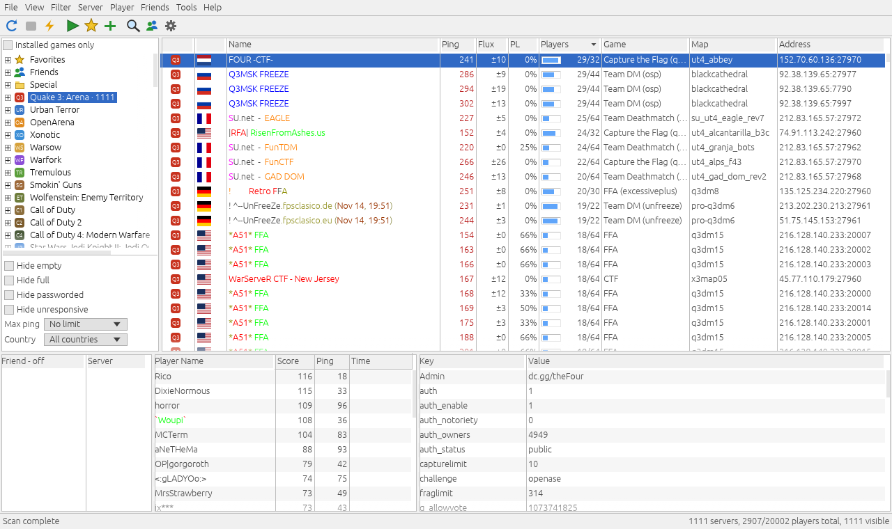

[English](README.md) | [Français](README.fr.md) | [Español](README.es.md) | [Português](README.pt.md) | [Italiano](README.it.md) | [Deutsch](README.de.md) | **Русский**

# OpenASE-Plus

**The All-Seeing Eye всё ещё следит.** Найдите сервер для классических игр, которые вы до сих пор любите, и подключитесь двойным щелчком.

OpenASE-Plus — бесплатный браузер серверов для Windows, Linux и macOS в духе старого *All-Seeing Eye*. Выберите игру, посмотрите, кто играет прямо сейчас, и заходите: без консольных команд и копирования IP.

<table>
  <tr>
    <td></td>
    <td></td>
  </tr>
</table>

Серверы Quake 3 в темах Classic, Dark и GoldSrc.

**[⬇ Скачать](https://github.com/OpenGamePlus/OpenASE-Plus/releases/latest)** · бесплатно и с открытым исходным кодом (GPL-3.0)

## Что он умеет

- 🎮 **80 классических игр в одном месте**: Quake, Call of Duty, Unreal Tournament, Counter-Strike, Medal of Honor, Battlefield, Tribes и многие другие.
- ⚡ **Двойной щелчок — и вы в игре**: он находит установленные игры и запускает их сразу с подключением, с нужным модом и паролем.
- 📶 **Пинг, Flux и потеря пакетов** измеряются как в оригинальном ASE, плюс версия каждого сервера.
- 🔎 **Быстро найдите нужный сервер**: фильтры по режиму игры, моду, карте, версии, пингу или стране; скрывайте пустые, полные или запароленные серверы; создавайте свои фильтры.
- ⭐ **Избранное, друзья и недавние серверы** — сервер вашего клана всегда в одном щелчке.
- 🔔 **Уведомления**, когда на полном сервере освобождается место, когда матч набирает игроков или когда друг заходит в сеть.
- 👥 **Играют сейчас**: один список всех занятых серверов во всех ваших играх.
- 🏠 **LAN-вечеринки**: находит серверы в вашей локальной сети.
- 🎨 **Шесть тем**, от Classic до Synthwave и GoldSrc, на семи языках: английском, французском, испанском, португальском, итальянском, немецком и русском.
- 🛠 **Для администраторов серверов**: консоль RCON и инструмент командной строки.

Все возможности подробно: [руководство пользователя](docs/user-guide.md) (на английском).

## Поддерживаемые игры

Сгруппированы по тому, как они общаются со своими серверами (по протоколу запросов).

| Протокол | Игры |
|---|---|
| Quake 3 | Quake 3: Arena, Urban Terror, OpenArena, Xonotic, Warsow, Warfork, Tremulous, Smokin' Guns, Wolfenstein: Enemy Territory, Return to Castle Wolfenstein, Call of Duty, Call of Duty: United Offensive, Call of Duty 2, Call of Duty 4: Modern Warfare, Star Wars Jedi Knight II: Jedi Outcast, Star Wars Jedi Knight: Jedi Academy, Star Trek: Voyager Elite Force, Soldier of Fortune II |
| Quake 2 и QuakeWorld | Quake 2, Kingpin, QuakeWorld |
| Doom 3 | DOOM 3, Quake 4 |
| Zandronum | Zandronum (Doom) |
| GameSpy | Unreal Tournament, Unreal, Deus Ex, Rune, Wheel of Time, Mobile Forces, Serious Sam: The First и Second Encounter, No One Lives Forever 1 и 2, Heretic II, Gore, Drakan, Turok 2, Global Operations, Vietcong, Star Trek: Bridge Commander, Medal of Honor: Allied Assault (+ Spearhead, Breakthrough), Battlefield 1942, SWAT 4, Soldier of Fortune |
| GameSpy v2 и v3 | Battlefield 2, Battlefield Vietnam, Halo: Combat Evolved, Halo: Custom Edition, Tribes: Vengeance, F.E.A.R., Star Wars: Battlefront |
| Unreal Engine 2 | Unreal Tournament 2004, Unreal Tournament 2003 |
| Tribes | Starsiege: Tribes, Tribes 2 |
| Valve (Steam)\* | Counter-Strike 1.6, Condition Zero, Team Fortress Classic, Day of Defeat, Half-Life, Opposing Force, Deathmatch Classic, Ricochet, Counter-Strike: Source, Day of Defeat: Source, Half-Life 2: Deathmatch, Team Fortress 2, Left 4 Dead, Left 4 Dead 2, Garry's Mod |
| Собственные | Multi Theft Auto: San Andreas, Savage: The Battle for Newerth, Rainbow Six 3: Raven Shield, Ghost Recon и The Sum of All Fears (+ demos) |

\* Для списка серверов нужен бесплатный [ключ Steam Web API](docs/user-guide.md#steam-games).

Какие мастер-серверы использует каждая игра: [игры и мастер-серверы](docs/games-and-masters.md).
Нет вашей игры? [Откройте issue](https://github.com/OpenGamePlus/OpenASE-Plus/issues).

> [!IMPORTANT]
> **Игры не входят в комплект.** OpenASE-Plus показывает серверы и запускает уже установленные у вас игры.

## Начало работы

1. **Скачайте** пакет для вашей системы со страницы [Releases](https://github.com/OpenGamePlus/OpenASE-Plus/releases/latest): `.zip` для Windows, AppImage или `.tar.gz` для Linux, `.zip` для macOS ([подробнее](docs/user-guide.md#install)).
2. **Запустите.** Windows и macOS могут предупредить, что приложение не подписано; в Windows нажмите **Подробнее → Выполнить в любом случае**, в macOS щёлкните по приложению правой кнопкой и выберите **Открыть**.
3. **Позвольте ему найти ваши игры** с помощью автопоиска при первом запуске.
4. **Выберите игру, нажмите `F5`, дважды щёлкните по серверу.** Вот и всё.

OpenASE-Plus сообщит, когда выйдет новая версия.

> [!NOTE]
> **Первый выпуск.** Команда подключения для многих новых игр ещё не проверялась с установленной игрой. Сообщайте о проблемах в [issues](https://github.com/OpenGamePlus/OpenASE-Plus/issues).

## Подробнее

Документация по ссылкам — на английском.

- 📖 [Руководство пользователя](docs/user-guide.md): все возможности, горячие клавиши, игры Steam и где хранятся настройки.
- 🛰 [Игры и мастер-серверы](docs/games-and-masters.md): мастер-серверы каждой игры.
- 💻 [Командная строка (`openase-cli`)](docs/cli.md): те же запросы без окна, с выводом в JSON.
- 🛠 [Сборка и участие](docs/README.md): техническая документация, [сборка](docs/development/building.md), [добавление игры](docs/development/adding-a-game.md), [CONTRIBUTING.md](CONTRIBUTING.md).
- 📜 [Что изменилось](CHANGELOG.md) и [что дальше](ROADMAP.md).

## О проекте

OpenASE-Plus — форк [OpenASE](https://github.com/tsautier/OpenASE) Тома Сотье (Thomas Sautier), часть семейства [OpenGamePlus](https://github.com/OpenGamePlus). Помимо OpenASE, в нём есть возможности JASE, более раннего браузера того же сопровождающего: больше игр, уведомления, ссылки, RCON, темы, флаги и изображения карт. Как и остальные проекты семейства, он разрабатывается с помощью ИИ-ассистентов для программирования. Это новый код: он не использует, не изменяет и не распространяет ничего из оригинальной программы Yahoo и не связан ни с Yahoo, ни с авторами оригинального The All-Seeing Eye.

Спасибо сообществам, которые поддерживают эти игры: 333networks, OpenSpy, dpmaster, jkhub, 1fxmod, TribesNext, OpenRVS, Savage DRX и многим другим.

## Лицензия

Copyright (C) 2026 Thomas Sautier (OpenASE)  
Copyright (C) 2026 OpenGamePlus contributors (OpenASE-Plus)

OpenASE-Plus — свободное программное обеспечение под лицензией GNU General Public License версии 3 или более поздней; см. [LICENSE](LICENSE). Названия игр — товарные знаки их владельцев. Геолокация IP от [DB-IP](https://db-ip.com) (CC BY 4.0), загружается во время работы. Флаги из [flag-icons](https://github.com/lipis/flag-icons) (MIT, `rust/assets/flags-LICENSE.txt`). Файлы оригинального ASE с этим проектом не распространяются.
